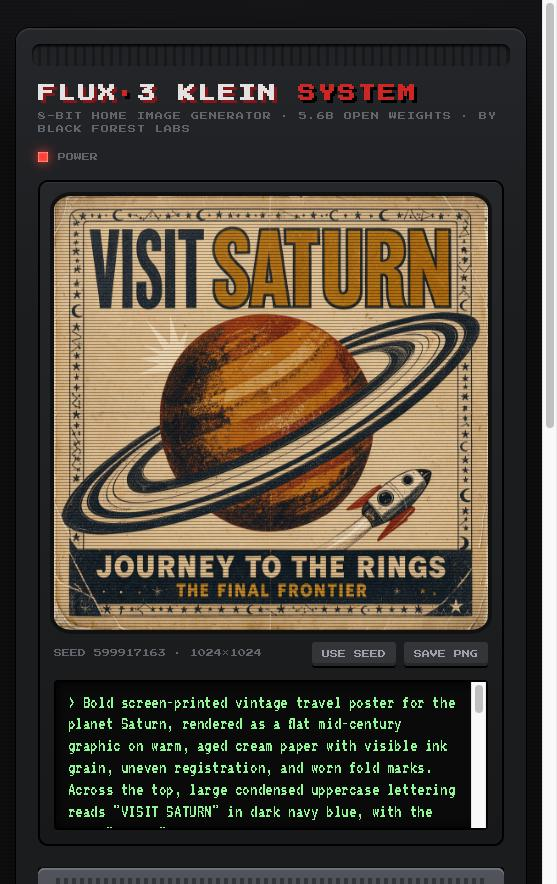

# 🎮 FLUX 3 Klein Console

**A dark, 8-bit home-console front-end for [FLUX 3 Image Klein](https://huggingface.co/black-forest-labs/flux-3-image-klein-comfy), Black Forest Labs' 5.6B open-weights image model.**

▶️ **Play it live:** [huggingface.co/spaces/marksenlit/flux3-klein-console](https://huggingface.co/spaces/marksenlit/flux3-klein-console)

<p align="center">
  
</p>

## What it does

Type a prompt into the cartridge slot, press **A**, and the image boots up on the CRT screen.

- **Text-to-image:** short prompts are fine. FLUX 3's prompt upsampler expands them into a full scene caption, which is printed on the screen afterwards.
- **Image editing and compositing:** load up to 4 reference images into the "memory cards" (click, drag, or paste), then describe the edit, e.g. *"put the cat from the first image on the sofa from the second image"*.
- **Two modes:** `TURBO` (distilled, 16 steps) and `CLASSIC` (base, 50 steps).
- **1K / 2K output** in 1:1, 4:3, 3:4, 16:9 or 9:16.
- **Seeds:** randomize, or press `USE SEED` to lock in one you liked.
- **Save files:** every image from this visit stays in a strip below the console. `SAVE PNG` downloads one.

### Controls

| Button | Action |
| --- | --- |
| **A** / **START** / `Ctrl+Enter` | Generate |
| **B** | Insert a random cartridge (example prompt) |
| **SELECT** | Switch TURBO / CLASSIC |
| **◀ ▶** | Cycle aspect ratio |
| **▲ ▼** | 2K / 1K |

## How it works

The whole app is a single `index.html` with no build step and no server of its own. It runs as a free
[static Hugging Face Space](https://huggingface.co/docs/hub/spaces-sdks-static).

When you press A, the browser uses [`@gradio/client`](https://www.npmjs.com/package/@gradio/client) to send the job to the
official [black-forest-labs/flux-3-image-klein](https://huggingface.co/spaces/black-forest-labs/flux-3-image-klein) Space.
That Space runs the model on ZeroGPU with the same checkpoints that are packaged for ComfyUI in
[flux-3-image-klein-comfy](https://huggingface.co/black-forest-labs/flux-3-image-klein-comfy).

```
your browser ──@gradio/client──▶ black-forest-labs/flux-3-image-klein (ZeroGPU)
     ▲                                   │  prompt upsampler → FLUX 3 Klein
     └──────────── image + caption ──────┘
```

Each request uses the visitor's own ZeroGPU quota. If you see **GAME OVER: quota exceeded**, sign in on huggingface.co or wait a bit.

## Run it locally

No install needed. Open the file, or serve the folder:

```bash
python3 -m http.server 8000
```

Then visit <http://localhost:8000>.

## Deploy your own copy

This repo is also the Space's git repo. To publish a fork as your own Space:

```bash
hf repos create <you>/flux3-klein-console --type space --space-sdk static
git remote add space https://huggingface.co/spaces/<you>/flux3-klein-console
git push space main
```

The root `README.md` holds the Space config (YAML front matter). This file, `.github/README.md`, is what GitHub shows.

## Credits and license

- Model: **FLUX 3 Image Klein** by [Black Forest Labs](https://bfl.ai), released under the [FLUX Kommunity License](https://huggingface.co/black-forest-labs/flux-3-image-klein-comfy/blob/main/LICENSE.md). Images you generate are subject to its terms.
- Fonts: [Press Start 2P](https://fonts.google.com/specimen/Press+Start+2P) and [VT323](https://fonts.google.com/specimen/VT323) (SIL Open Font License).
- This is a fan-made demo and is not affiliated with or endorsed by Black Forest Labs. FLUX is a trademark of Black Forest Labs.
